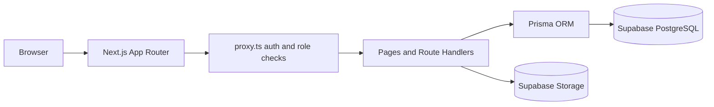
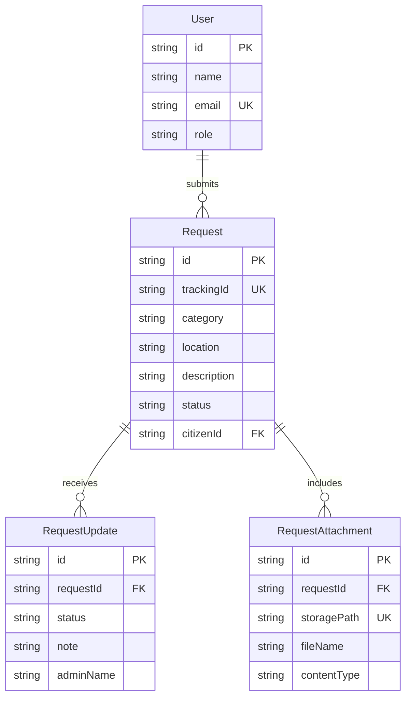

# Murang'a County Public Service Portal

A secure portal for Murang'a County residents to report municipal service issues and track their resolution.

## Demo Credentials

| Role | Email | Password |
| --- | --- | --- |
| Admin | `admin@muranga.go.ke` | `Demo1234!` |
| Citizen | `citizen@muranga.go.ke` | `Demo1234!` |

Log in at `/login`; the system routes you to the correct dashboard based on role.

## Live Demo

[your-vercel-url]

## Screenshots

Add screenshots to `docs/screenshots/` and update these paths when available.

| Screen | Screenshot |
| --- | --- |
| Landing page | `docs/screenshots/landing.png` |
| Citizen dashboard | `docs/screenshots/citizen-dashboard.png` |
| New request | `docs/screenshots/new-request.png` |
| Admin dashboard | `docs/screenshots/admin-dashboard.png` |
| Request detail | `docs/screenshots/request-detail.png` |
| Public tracking | `docs/screenshots/public-track.png` |

## Features

### Citizen

- Register and sign in using a secure HttpOnly session cookie.
- Report municipal issues across streetlight, water, garbage collection, roads, drainage, and other categories.
- Include the issue location, a description, and up to five supporting files.
- Review reports, status, timeline updates, and authorized attachment downloads.

### Admin

- View all reports and citizen details.
- Filter reports by status and inspect report timelines.
- Update status and add an administrative note.
- Review totals, open/resolved counts, status distribution, and resolution rate.

### Public

- Track a report by its tracking ID without signing in.
- Read public status updates without exposing citizen identity or attachment URLs.

## Tech Stack

- Next.js 16 App Router and TypeScript
- Prisma ORM
- Supabase PostgreSQL and Supabase Storage
- Tailwind CSS and shadcn/ui
- Zod, React Hook Form, and `jose` cookie-based JWT authentication

## Architecture



## Database Schema



## Local Setup

1. Clone the repository and enter its directory.
2. Install packages with `npm install`.
3. Create a local `.env` file and fill in the database URLs, Supabase keys, and a strong `JWT_SECRET`. The `.env.example` template was removed from this repository; use the Environment Variables table below as your checklist. Never commit `.env`.
4. Create a public Supabase Storage bucket named `request-attachments`.
5. Apply the Prisma schema with `npx prisma db push`.
6. Seed demo accounts with `npx prisma db seed`.
7. Start the application with `npm run dev` and visit `http://localhost:3000`.

## Environment Variables

| Variable | Description |
| --- | --- |
| `DATABASE_URL` | Supabase transaction-pooler URL for application runtime. |
| `DIRECT_URL` | Supabase direct/session-pooler URL for Prisma schema operations. |
| `NEXT_PUBLIC_SUPABASE_URL` | Supabase project URL used by the server storage client. |
| `NEXT_PUBLIC_SUPABASE_ANON_KEY` | Supabase publishable/anonymous key. |
| `SUPABASE_SERVICE_ROLE_KEY` | Server-only key for privileged Storage operations; never expose it in client code. |
| `JWT_SECRET` | Random secret of at least 32 bytes used to sign session tokens. |

Do not commit `.env` or production credentials.

## Roles

Public registration always creates a `CITIZEN`. To promote a user manually, open Supabase **Table Editor → User**, find the user by email, and change `role` to `ADMIN`. Do not share administrator credentials or grant admin access to untrusted accounts.

## Status Workflow

`PENDING → IN_PROGRESS → RESOLVED`

## Deployment

1. Create a Supabase project and configure the `request-attachments` bucket.
2. In Vercel, configure `DATABASE_URL`, `DIRECT_URL`, `NEXT_PUBLIC_SUPABASE_URL`, `NEXT_PUBLIC_SUPABASE_ANON_KEY`, `SUPABASE_SERVICE_ROLE_KEY`, and `JWT_SECRET` for the appropriate environments.
3. Before the first production request, run `npx prisma db push` against the production database.
4. Seed initial accounts as needed with `npx prisma db seed`, then deploy the application through Vercel.
5. Use a new, unique `JWT_SECRET` in production and restrict access to the Supabase service-role key.

## Project Structure

```text
app/
  (auth)/             Sign-in and registration
  admin/              Staff overview and report management
  api/                Authentication, request, and tracking handlers
  dashboard/          Citizen dashboard and municipal reports
  track/              Public tracking interface
components/
  admin/              Staff update form
  auth/               Login form
  requests/           Citizen request form
  shared/             Navigation, tables, badges, and empty states
  ui/                 shadcn/ui primitives
lib/                  Authentication, Prisma, Supabase, and utilities
prisma/               Schema and demo seed script
```

## Author

Add project author name and contact details here.
