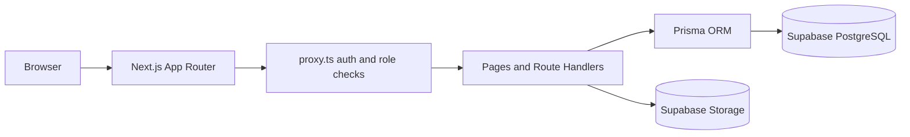
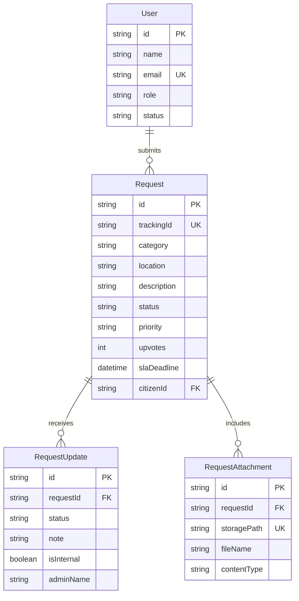

# Murang'a County Public Service Portal

A secure portal for Murang'a County residents to report municipal service issues and track their resolution.

## Demo Accounts

Demo accounts are not created by default. For a local interview/demo environment, set `DEMO_SEED_ENABLED=true` and provide a unique `DEMO_ACCOUNT_PASSWORD` of at least 12 characters in `.env`, then run `npx prisma db seed`. This seed is blocked in production. The accounts are `admin@muranga.go.ke` and `citizen@muranga.go.ke`; both use the configured demo password. Disable/remove them before using a shared or production database.

## Features

### Citizen

- Register and sign in using a secure HttpOnly session cookie.
- Report municipal issues across streetlight, water, garbage collection, roads, drainage, and other categories, with Low, Normal, High, or Critical priority and up to five supporting files.
- Check for active duplicate reports and recently resolved reports in the same category and area before submitting. Citizens can support an existing report with one upvote; owners cannot upvote their own reports.
- Review personal reports, status updates, image previews, authorized attachment downloads, notifications, and requests overdue past the three-day SLA.
- Browse a community page of open requests and upvote reports from other residents.

### Admin

- Monitor request totals, the 24-hour pending queue, SLA-overdue cases, recent activity, and community upvotes.
- Search reports by tracking ID, citizen, or location; inspect full timelines and attachments; and update request status with public or internal notes.
- Manage user accounts, including suspending or reactivating accounts, and review request counts by user.
- Use the Reports Dashboard for date-filtered metrics, category and submission trends, overdue totals, and CSV export.
- Configure county contact details and the default SLA, and receive notifications about new reports.

### Public

- Track a report by its tracking ID without signing in.
- Read its category and status timeline without exposing citizen identity, exact location, report description, admin notes, or attachment URLs.
- View the public transparency board with county-level totals, resolved counts, top category, and an anonymized activity feed.

## Tech Stack

- Next.js 16 App Router and TypeScript
- Prisma ORM
- Supabase PostgreSQL and Supabase Storage
- Tailwind CSS and shadcn/ui
- Zod, React Hook Form, and `jose` cookie-based JWT authentication

## Architecture


## Database Schema



## Local Setup

1. Clone the repository and enter its directory.
2. Install packages with `npm install`.
3. Copy `.env.example` to `.env`, then set the database URLs, Supabase credentials, and a random `JWT_SECRET` (at least 32 bytes; `openssl rand -base64 48`). Never commit `.env`.
4. Create a **private** Supabase Storage bucket named `request-attachments`. The server streams files through an authenticated route.
5. Apply checked-in migrations with `npx prisma migrate deploy`. After pulling schema updates, regenerate the Prisma client with `npx prisma generate`.
6. To create local demo users, set `DEMO_SEED_ENABLED=true` and a unique `DEMO_ACCOUNT_PASSWORD` of at least 12 characters, then run `npm run db:seed`. A role-specific login link shows that role's demo email and password; plain `/login` shows no demo credentials. The configured demo password is displayed on the role-specific login page, so only use a password for dedicated demo accounts with no real or sensitive access. Do not use demo users or passwords for real production access.
7. Start the application with `npm run dev` and visit `http://localhost:3000`.

## Environment Variables

| Variable | Description |
| --- | --- |
| `DATABASE_URL` | Supabase transaction-pooler URL for runtime. For a long-running Next.js app, use a small pool such as `connection_limit=5&pool_timeout=30` to handle concurrent page/API requests. |
| `DIRECT_URL` | Supabase direct/session-pooler URL for Prisma schema operations. |
| `NEXT_PUBLIC_SUPABASE_URL` | Supabase project URL used by the server storage client. |
| `NEXT_PUBLIC_SUPABASE_ANON_KEY` | Supabase publishable/anonymous key. |
| `SUPABASE_SERVICE_ROLE_KEY` | Server-only key for privileged Storage operations; never expose it in client code. |
| `JWT_SECRET` | Random secret of at least 32 bytes used to sign session tokens. |
| `DEMO_SEED_ENABLED` | Set to `true` only for non-production demo databases. Defaults to disabled. |
| `DEMO_ACCOUNT_PASSWORD` | Unique password (12+ characters) used only when explicitly seeding demo users. |

Do not commit `.env` or production credentials.

## Roles

Public registration always creates a `CITIZEN`. To promote a user manually, open Supabase **Table Editor → User**, find the user by email, and change `role` to `ADMIN`. Do not share administrator credentials or grant admin access to untrusted accounts.

## Status Workflow

`PENDING → IN_PROGRESS → RESOLVED`

New reports receive a three-day SLA deadline. Administrators can also save the county's default SLA value in Settings.

## Deployment

1. Create a Supabase project and configure the private `request-attachments` bucket.
2. In Vercel, configure `DATABASE_URL`, `DIRECT_URL`, `NEXT_PUBLIC_SUPABASE_URL`, `NEXT_PUBLIC_SUPABASE_ANON_KEY`, `SUPABASE_SERVICE_ROLE_KEY`, and `JWT_SECRET` for the appropriate environments.
3. Before the first production request, run `npx prisma migrate deploy` against the production database.
4. Provision the first administrator through a controlled database/operations process; never run the demo seed in production.
5. Use a new, unique `JWT_SECRET` in production and restrict access to the Supabase service-role key.
6. Configure a production email provider before offering account recovery or email alerts; those delivery flows are not implemented in this demo.
7. Add a shared rate-limit store at the hosting edge before exposing registration, login, or public tracking to untrusted high-volume traffic. In-memory limits are not reliable across serverless instances.
8. Set up database backups, storage retention, and deployment monitoring with the service operators before handling real citizen reports.

## Quality Checks

Run `npm run lint`, `npm run typecheck`, and `npm test` before submitting changes. The GitHub Actions workflow runs the same checks for pushes to `main`/`master` and pull requests. Tests currently cover the public tracking response privacy boundary; this is a compact interview project, so broader API and browser end-to-end coverage remains a useful next step.

## Project Structure

```text
app/
  (auth)/             Sign-in and registration
  admin/              Staff overview and report management
  api/                Authentication, request, and tracking handlers
  dashboard/          Citizen dashboard and municipal reports
  track/              Public tracking interface
components/
  admin/              Staff update form
  auth/               Login form
  requests/           Citizen request form
  shared/             Navigation, tables, badges, and empty states
  ui/                 shadcn/ui primitives
lib/                  Authentication, Prisma, Supabase, and utilities
prisma/               Schema and demo seed script
```
